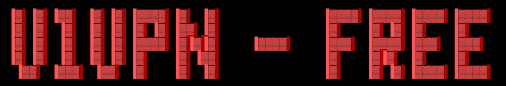

<div align="center">



<br>

**Сборник бесплатных VPN-подписок для обхода блокировок и ограничений.**
Одна страница, один клик — и ссылка уже в буфере обмена.

<br>

<a href="https://v1vpn-free.duckdns.org/"></a>


<br><br>

[🌐 Сайт](https://v1vpn-free.duckdns.org/) •
[📖 Инструкция](https://v1vpn-free.duckdns.org/guide.html) •
[🚀 Быстрый старт](#-быстрый-старт) •
[📡 Подписки](#-подписки)

</div>

---

## ✨ Возможности

- 📋 **13 подписок** из трёх проверенных публичных источников в одном месте
- 📋 **Копирование в один клик** — кнопка рядом с каждой ссылкой, с запасным вариантом для старых браузеров
- 📖 **Пошаговая инструкция** по подключению для телефона и компьютера
- 🔗 **Ссылки ведут напрямую на источники**, поэтому ключи берутся у авторов
- 🌑 **Тёмный минималистичный интерфейс** с блюром, адаптивный под телефон
- 🪶 **Лёгкий сайт**: чистые HTML, CSS и JS, без фреймворков и сборки

---

## 🚀 Быстрый старт

<table>
<tr>
<td width="50%" valign="top">

### 📱 Телефон (iOS / Android)

1. Установи **Happ Proxy** из App Store или Google Play
2. Открой [сайт](https://v1vpn-free.duckdns.org/) и нажми **«Скопировать»** у любой подписки
3. В Happ нажми **«+»** → **«Вставить из буфера обмена»**
4. Выбери сервер с низким пингом
5. Нажми круглую кнопку подключения

</td>
<td width="50%" valign="top">

### 💻 Компьютер (Windows / macOS / Linux)

1. Установи **Hiddify** или **Nekoray**
2. Скопируй ссылку на [сайте](https://v1vpn-free.duckdns.org/)
3. В программе нажми **«Новый профиль»** и вставь ссылку
4. Включи режим **TUN / Прокси**
5. Нажми кнопку подключения

</td>
</tr>
</table>

> 💡 **Совет:** раз в 1–2 дня обновляй подписку в приложении, чтобы подтягивать новые рабочие серверы. Если сервер перестал работать, переключись на другой или возьми другую подписку.

Подробная версия — на странице [**Инструкция по подключению**](https://v1vpn-free.duckdns.org/guide.html).

---

## 📡 Подписки

Все ссылки собраны на [сайте](https://v1vpn-free.duckdns.org/) и копируются одной кнопкой. Протоколы в подписках: **VLESS**, **Shadowsocks**, **Hysteria2** и другие, есть и конфиг для **Clash**.

<details>
<summary><b>🔹 igareck / vpn-configs-for-russia</b> — 4 подписки</summary>

<br>

| Подписка |
|---|
| `BLACK_SS_WEAK_DPI_RUS` |
| `BLACK_SS+All_RUS.txt` |
| `BLACK_VLESS_RUS.txt` |
| `BLACK_VLESS_RUS_mobile.txt` |

Источник: [github.com/igareck/vpn-configs-for-russia](https://github.com/igareck/vpn-configs-for-russia)

</details>

<details>
<summary><b>🔹 kort0881 / vpn-vless-configs-russia</b> — 5 подписок</summary>

<br>

| Подписка |
|---|
| NodeFree Mirror |
| V2RaySE Free Share |
| Gist V2Ray Node Share |
| Gist Clash Config (`.yaml`) |
| VLESS Full Output (`vless.txt`) |

Источник: [github.com/kort0881/vpn-vless-configs-russia](https://github.com/kort0881/vpn-vless-configs-russia)

</details>

<details>
<summary><b>🔹 FLAT447 / v2ray-lists</b> — 4 подписки</summary>

<br>

| Подписка |
|---|
| `BLACK_FULL.txt` |
| `BLACK_LTE.txt` |
| `WHITE_FULL.txt` |
| `WHITE_LITE.txt` |

Источник: [github.com/FLAT447/v2ray-lists](https://github.com/FLAT447/v2ray-lists)

</details>

---

## 📁 Структура репозитория

```text
V1Vpn-Free/
├── static/
│   ├── css/style.css         # тёмная тема с блюром
│   └── js/main.js            # копирование ссылок и уведомления
├── index.html                # главная: список подписок
├── guide.html                # инструкция по подключению
└── ascii-art-text.png        # баннер проекта
```

---

## 🖥 Запуск у себя

Проект статический, сборка не нужна.

```bash
git clone https://github.com/v1kserr/V1Vpn-Free.git
cd V1Vpn-Free
python3 -m http.server 8080
```

Открой `http://localhost:8080/` в браузере.

---

## 🗺 Планы

- [x] Сайт со списком подписок и копированием в один клик
- [x] Инструкция по подключению
- [ ] Больше подписок, разложенных по типам и протоколам
- [ ] Своё веб-приложение
- [ ] Собственный VPN

---

## ⚠️ Важно

- Ключи в подписках **публичные и принадлежат сторонним авторам**. Проект их только собирает и не владеет серверами.
- Владелец публичного сервера теоретически может видеть метаданные трафика. **Не вводи пароли, данные банковских карт и другую чувствительную информацию** без HTTPS.
- Серверы бесплатные, поэтому скорость и стабильность не гарантируются.
- Соблюдай законы своей страны. Ответственность за использование лежит на тебе.

---

## 🙏 Благодарности

Подписки на сайте собраны из репозиториев:

- [igareck/vpn-configs-for-russia](https://github.com/igareck/vpn-configs-for-russia)
- [kort0881/vpn-vless-configs-russia](https://github.com/kort0881/vpn-vless-configs-russia)
- [FLAT447/v2ray-lists](https://github.com/FLAT447/v2ray-lists)

Клиенты, которые мы рекомендуем: **Happ**, **Hiddify**, **Nekoray**.

---

<div align="center">

**V1Vpn — Free** · `0.1.0 alpha` · сделано [@v1kserr](https://github.com/v1kserr)

⭐ Если проект пригодился, поставь звезду.

</div>